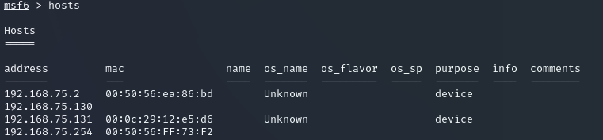
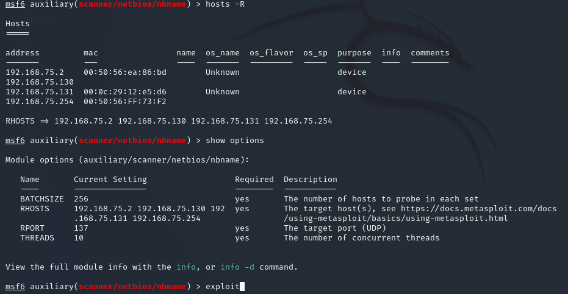
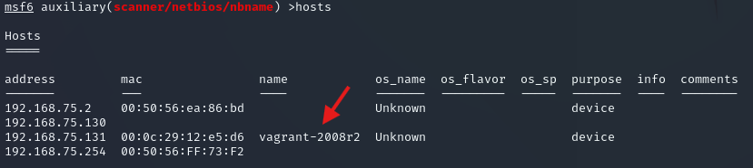
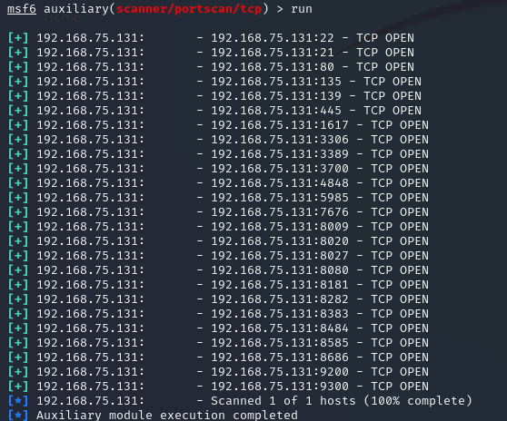
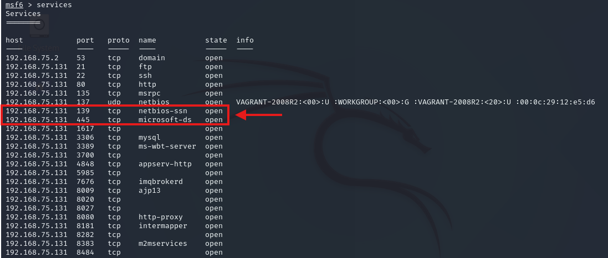
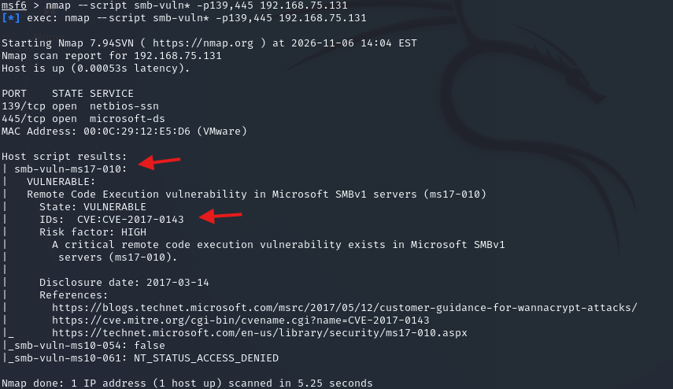

# Cyber-Kill-Chain-com-Metasploit

# RECONHECIMENTO

Fase responsavel por reconhecer o ambiente, portas, vulnerabilidades

1. Criando BD Pentest para Armazenar os resultados 
```bash
workspace -a pentest
```

2. NMAP - Descobrindo todos os IPs da Rede 75 e armazenando no BD
```bash
db_nmap 192.168.75.0/24
hosts
```



3. Descobrindo todos os hosts com os IPs no BD
```bash
use auxiliary/scanner/netbios/nbname
hosts -R
exploit
```



4. Hosts descobertos
hosts



Vamos utilizar a maquina 131

6. Descobrindo as portas e os serviços 
```bash
use auxiliary/scanner/portscan/tcp
set RHOSTS 192.168.75.131
exploit
```



Comando mostra os serviços que estão nas maquinas
```bash
services
```



Identificado as portas 130 e 445 do SMB.

Enumerando as vulnerabilidades de SMB da maquina
```bash
nmap --script smb-vuln* -p139,445 192.168.75.131
```


Vamos explorar essa vulnerabilidade do Eternal Blue

Essa fase também é responsavel por identificar os mecanismos de defesa, e utilizar um encoder para evasão das defesas

Um encoder modifica o binário do script do Payload para fazer o by-pass do antivírus do alvo.


### 1. Scan de todas as portas

# ARMAMENTO

